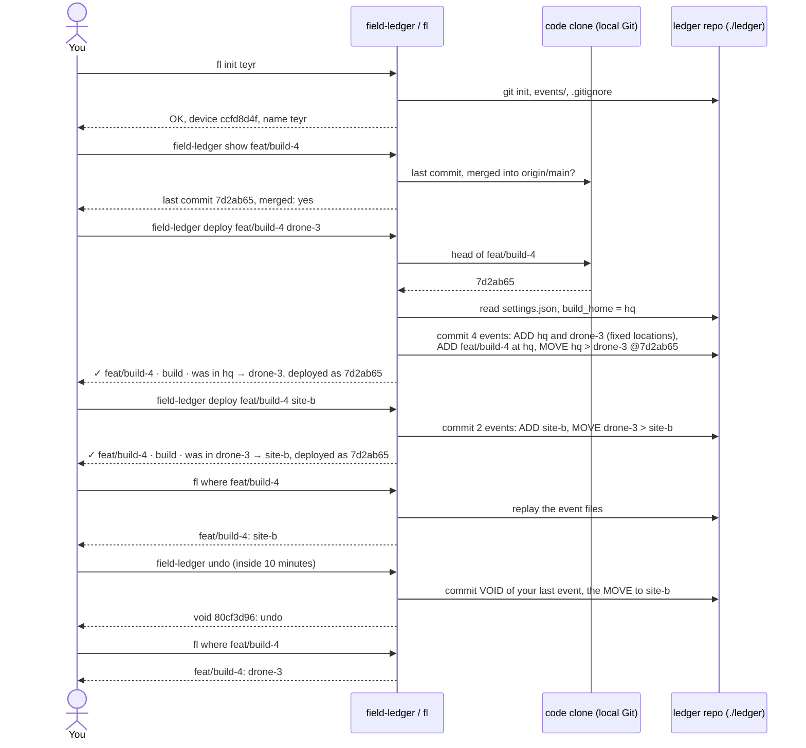

# field-ledger

A shadow board for things in flight. Everything checked out has a visible slot, and an
empty slot is a question someone has to answer.

**One tool, two modes:**

| Mode | Tracks | Answers |
|---|---|---|
| Field | Physical items: batteries, cameras, gazebos, vans | Where is BAT-12, and who moved it last? |
| Code | Branches and builds | Which build is at which location? Which branches are going stale? |

Both modes share one model (nodes, events, one replay function) and one command grammar.

Python 3.10+, standard library only. Nothing to install on a field laptop.

> **Status.** This README describes the target design. Each section says what works today
> (**v0**) and what is **planned**. If they disagree, the v0 line is what the code does.
>
> **Decisions vs mechanics.** Design decisions (the model, what events mean, the conflict and
> trust rules, scope, deadlines) live in a private design doc. This README is canonical for
> mechanics: commands, grammar, settings, file formats and setup. If the two disagree, the
> decision stands and this README gets fixed.

---

## Quick start (v0)

```bash
pip install -e .                     # installs the `fl` command
fl init teyr                         # once per laptop: creates ./ledger, sets your name
fl kit kit.csv                       # create item groups (see "Items and IDs")
fl move BAT-07 site-b                # log a move; prints the logged event and its ID
fl move BAT-07 CAS-01                # an item ID as destination packs it into that case
fl move CAS-01 van                   # ...and everything inside the case goes with it
fl where BAT-07                      # BAT-07: van (in CAS-01)
fl at site-b                         # everything there, including inside cases
fl flags                             # everything that needs a second look
fl undo                              # cancel your own last event, within 10 minutes
fl void <event-id> "wrong battery"   # correct a mistake (history is kept)
```

Without installing: `python -m field_ledger.ledger`.

---

## The model

**Everything is a node.** A battery, a case, a van and a site are all nodes. Every node has:

- an **ID** (`BAT-12`),
- a **kind** (`battery`), which defines the states it can be in,
- one **parent**: the node it sits in (BAT-12 in Case A, Case A in the van, the van at Site B).

**Locations are fixed nodes.** A site or storeroom is a node flagged `fixed`: it can hold
things but can't be moved on the fast path. Locations can nest too (Site B > Storeroom).

**Contents follow their container.** Moving the van moves everything in it, in one event.
Moves that would create a loop (the van inside BAT-12) are rejected.

**Location and state are separate.** Where a battery is (its parent) and what's happening to
it (its state) change independently. Battery states by default:

| State | Meaning |
|---|---|
| `ready` | Charged, good to fly |
| `depleted` | Needs a charge |
| `storage` | Storage-charged for the long term |
| `damaged` | Puffed or dropped: don't fly it |

Kinds and their states are config, not code: add or edit them freely.

**Only log containment that lasts beyond a work session.** A battery's parent is its case,
charger station or van, never the drone it is flying in. Test: *would I chase someone about
where this is tomorrow?* If not, it isn't a parent.

**Bulk items** (cable ties, spare props) are one node with an optional count.

Status: **v0** has nesting, and `field-ledger deploy` creates its destination as a fixed
location node (moving one asks for confirmation). Locations named by `fl move` are still
free text, and older ledgers full of them keep working. Kinds and states are **planned**.

---

## Items and IDs

IDs are `KIND-NN`: a 3-letter prefix and a number (`BAT-07`, `GAZ-03`).

- The number's minimum width is a setting, `id_digits` (default `2`). Numbers past the width
  still work (`BAT-100`).
- Kit file:

  ```csv
  prefix,name,count,location
  BAT,Battery,12,truck
  CAM,SIYI camera,3,case-1
  ```

  Creates `BAT-01`..`BAT-12` and `CAM-01`..`CAM-03`. Re-running the same file changes nothing;
  raising a count only adds the missing items. `fl add BAT 2 --at truck` adds BAT-13, BAT-14.

Status: **v0** pads to 2 digits (fixed). `id_digits` is **planned**.

---

## Logging a move

**On a phone (planned):** tap an item, drag it to where it went. Under 2 seconds.
**From the CLI or chat (v0):** the text grammar below.

Every move prints a **readback** with the item's previous location:

```
✓ BAT-12 · Blue 6S · was in Case A → van        [Undo]
```

If the "was in" doesn't match what's in your hand, you have the wrong ID: tap Undo.

Status: **v0** `field-ledger deploy` prints the readback with the previous location
(`✓ feat/x · build · was in site-b → drn-03, deployed as 4b7e0d1`) and `fl undo` /
`field-ledger undo` cancel it. `fl move` still prints the logged event
(`logged: 5918e80f  BAT-02  van > site-b`); its readback is **planned**. The "from" side
is where the log last had the item, whether or not you typed one; a typed one is only
checked against it (`from-mismatch` below).

### Text grammar (v0)

The same grammar works with `fl run "..."`, imported files, and (planned) the phone board and bot.

```
MOVE <ITEM> [<FROM>] > <TO>     MOVE BAT-07 truck > site-B
WHERE <ITEM>
AT <LOCATION>
VOID <EVENT-ID> <reason>        VOID 3f9a2c1e wrong battery
RENAME <OLD> > <NEW>            RENAME site-bb > site-b   (location typo fix)
```

### What gets accepted (v0)

| Input | Verdict | Why |
|---|---|---|
| `MOVE BAT-07 > site-b` | OK | |
| `move bat7 > Site-B` | OK | ID format and case are canonicalised by fixed rules |
| `MOVE BTA-07 > site-b` | REJECT, "did you mean BAT-07?" | Fuzzy matches are suggested, never auto-corrected |
| `MOVE BAT-99 > site-b` | REJECT | Not in the kit. Add it with `fl add` |
| `MOVE BAT-07 truck > site-b`, log says `site-a` | WARN, written + `from-mismatch` | Someone moved it without logging. Rejecting would throw away true information |
| `MOVE BAT-07 > site-bb` (close to `site-b`) | CONFIRM, "did you mean site-b?" | Probable typo, caught before entry |
| `MOVE BAT-07 > site-b` when already at `site-b` | CONFIRM | Probably moved away and back without being logged |
| Same move, same person, within 2 minutes | IGNORED | Double tap |
| `MOVE BAT-07` | REJECT, shows usage | |

CONFIRM asks `Log it anyway? [y/N]`. `--yes` answers yes; with no terminal the answer is no.
Exit codes: `0` written or ignored, `1` rejected, `2` confirmation declined.

Planned change: once locations are fixed nodes, an unknown destination (`yoeng's bag`) is a
new *item* to create, not a new location.

### Corrections never edit history

| Mistake | Fix | Status |
|---|---|---|
| Just logged the wrong move | **Undo** within 10 minutes (`undo_minutes`). Undo is a VOID of your own last event; after the window it is refused and asks for `void <id> <reason>` | v0 |
| Older wrong entry | `fl void <id> <reason>`. The event stays, marked void; the item goes back to where it was | v0 |
| Location typo | `fl rename-location site-bb site-b`. Views show the new name; stored events keep what was typed | v0 |

---

## Who and when

Every event records:

| Field | Meaning |
|---|---|
| `logged_by` | Who logged it. Automatic: from the phone's device ID or the Telegram sender. **This is who gets chased** |
| `moved_by` | Who carried it, if different. Optional, defaults to `logged_by`, editable later |
| `actor_source` | `device`, `telegram` or `import` |
| `occurred_at` | When it happened (phone clock) |
| `recorded_at` | When the hub received it |
| `time_source` | `device`, `prompted` or `import`. A prompted time was typed in later and is approximate |

No logins and no PINs. The threat model is honest mistakes. On first open, a phone picks its
person from the ledger's **People** list.

Status: **v0** records the logging person and the import time only. The rest is **planned**.

---

## When two moves disagree (planned)

Normally the latest move wins. A move gets a **⚠** instead when all of these hold:

1. Two moves affect the same node's location (directly, or through its container),
2. their times are within `conflict_window`,
3. they disagree on the destination, **and**
4. they came from different devices, or either time is `prompted` / `import`.

Two exact-timed moves from the same phone never conflict: the phone's sequence number orders them.
Same destination from two devices is a duplicate and is merged.

A ⚠ item shows the latest location plus the other candidate. One tap confirms either and writes a
`RESOLVE` event. Anyone can resolve. A ⚠ older than `nudge_after` gets a bot nudge to the
ledger's **field-ops owner**.

**Every ledger has a field-ops owner**, picked from the People list when the ledger is created.
Nothing can be moved until one is set. Handover is its own event (`OWNER teyr → ivan`). Only the current owner can
hand over, except that anyone may claim ownership once a nudge has gone unanswered for
`nudge_after`; the claim is an ordinary, attributed `OWNER` event.

---

## In the field (planned)

| Piece | What it is |
|---|---|
| **Network** | A travel router (preferred) or a phone hotspot. Laptops join as normal clients. Don't use a laptop hotspot |
| **Hub** | One laptop runs `field-ledger serve`: it serves the phone board, writes events and commits them. Give it a fixed address on the router (DHCP reservation) |
| **Phones** | Open the board in a browser and add it to the home screen. Moves queue on the phone if the hub is unreachable and send when it's back |
| **Relay** | When phones can't reach the hub (company or public Wi-Fi, or no hub on site), moves go through the Telegram bot. The hub fetches them over outbound HTTPS. The bot carries moves; it is never the record |
| **Backup** | The hub pushes the ledger repo when it has internet |

### Takeover: the hub laptop dies

1. Stop the old hub if it's still running (only one hub may poll the bot).
2. On another laptop: clone the ledger repo (from its remote, or a USB `git bundle`).
3. Copy the bot token file (see "Secrets").
4. Run `field-ledger serve`. Phones send their queued moves; the bot hands over anything it held.

Telegram keeps relayed moves for 24 hours. After that, recover them from a chat export with
`fl import`.

### No laptop on site

Phones must already have the board installed. Moves go through the bot; if a move has no time,
the bot asks for one. A rough time beats none, and it's marked `prompted`.

### v0 today

| Situation | What to do |
|---|---|
| No network at all | Every laptop logs to its own ledger repo. Afterwards: `git pull` in `ledger/` from the other laptop (or a USB `git bundle`); `fl` picks up the new event files on its next run |
| An older ledger (SQLite only) | `fl merge other-laptop.db` copies its events in and writes them as event files |
| Phones only | Type commands into chat or a notes app, then `fl import notes.txt` |

`fl import` picks up UPPERCASE commands anywhere in a line, so a chat export line like
`[17/10/26, 13:05] Teyr: MOVE BAT-07 > site-B` works and ordinary chat is skipped. Re-running
`merge` or `import` adds nothing twice, and a line that repeats the previous move of the same
item (same destination) is ignored, judged from the text alone. v0 limit: imported lines are attributed to the importer
and timestamped at import time.

---

## Code mode

A build is a node of kind `build`. Its parent is where it is deployed:

```bash
field-ledger deploy feat/secure-cdr drn-03 --repo /path/to/repo
# ✓ feat/secure-cdr · build · was in site-b → drn-03, deployed as 4b7e0d1
```

The destination may be a location (created as a fixed location node the first time it is
named) or an item ID, which deploys the build onto that thing. The deploy records the
branch's head commit in the event's `sha` field (full SHA; empty if unknown), read from
`--repo` without fetching; with no such branch there the move is still recorded and the
readback says `commit unknown`. `field-ledger undo` takes it back within 10 minutes.

Code comes from somewhere too: a build's first deploy starts at `build_home` (default `hq`,
change it with `fl set build_home <location>`), so it reads `was in hq → drn-03`, and
undoing that first deploy puts the build back at `hq`.

Branch age, last commit and merge state come from **local Git** and work offline and airgapped.

```bash
field-ledger show feat/secure-cdr --repo /path/to/repo   # no fetch
# feat/secure-cdr
#   age: 2 day(s) since the last commit
#   last commit: 9c1d4ae  2026-10-26 18:40  teyr  harden the CDR path
#   merged into origin/main: no
#   at drn-03, deployed as 4b7e0d1
```

The deployed commit is recorded, not compared: nothing yet tells you the branch has moved
on since. PR/MR status from GitHub or GitLab is optional and needs a token.

### Sample: one build, end to end (v0)

The stage 5 trial (2026-10-28), run on a fresh clone of this repo. Every command reads
local Git only; nothing is fetched.



The tool repo's `git status` stays clean throughout: the ledger is its own repo in a
gitignored folder.

### Stale-work board (v0)

Every remote branch is a tool checked out; a branch merged and deleted is a tool back in its slot.

| Label | Meaning | Usual fix |
|---|---|---|
| `no-PR` | Branch exists, nobody has been asked to review it | Open the PR, or delete the branch |
| `PR-stale` | PR open, untouched for more than `--stale-days` | Ping the reviewer, or close it |
| `merged-not-deleted` | Every commit already in `--base` | Delete the remote branch |
| `in-flight` | PR open and moving | Nothing |

```bash
python -m field_ledger --repo /path/to/repo --base origin/develop
python -m field_ledger --repo /path/to/repo --base origin/develop --prs gh --hide-in-flight
```

It runs `git fetch --prune` first (`--no-fetch` skips it and works offline). Use a full clone:
a shallow one breaks `merged-not-deleted`. On WSL, repos under `/mnt/c/...` work but Git is slower.

Known gaps: `--prs glab` flags differ across glab versions (NEEDS VERIFICATION); `--prs gh` is
unit-tested but not yet run against a live repo; fork PRs are matched by branch name only.

---

## Storage and privacy

This tool's repo is **public**. Ledger data never goes in it.

- **The record:** each ledger is its own Git repo inside a gitignored folder (`ledger_dir`,
  default `./ledger`), created by `field-ledger init` (`--ledger-dir` to put it elsewhere).
  One JSON event file per move, committed as it is written; Git gives history, merge and
  offline commits. A new file is never a merge conflict, so two people logging offline is a
  non-event. Give it a private or internal remote, or none on airgapped sites.
  Running `init` twice is safe: nothing already on disk is touched.
- **The cache:** one SQLite file, `./field-ledger.db` (override with `--db` or `FL_DB`),
  gitignored. `fl` writes every event to the files first, then the cache, and picks up new
  files (from a `git pull`) each time it starts. `fl rebuild` recreates it from the files;
  `--ledger-dir` / `FL_LEDGER_DIR` point `fl` at a ledger elsewhere.

### Secrets

Bot tokens and forge tokens live in a local, gitignored file or an environment variable.
Never commit them. Copying the token file is part of takeover.

---

## Settings (planned)

| Setting | Default | What it does |
|---|---|---|
| `id_digits` | `2` | Minimum width of the ID number |
| `undo_minutes` | `10` | How long the one-tap Undo is offered |
| `conflict_window` | `5 min` device / `60 min` prompted or import | How close two moves must be to get a ⚠ |
| `nudge_after` | `1` working day | When an unresolved ⚠ nudges the field-ops owner |
| `ledger_dir` | `./ledger` | Where the ledger's own repo lives |
| `build_home` | `hq` | Where a build is before its first deploy. **v0**: `fl set build_home <location>`; stored in the ledger repo's `settings.json`, so every device shares it |

---

## Layout (v0)

| Module | Job | Pure? |
|---|---|---|
| `ledger/model.py` | Data types | yes |
| `ledger/ids.py` | Item ID and location rules | yes |
| `ledger/parse.py` | Text grammar | yes |
| `ledger/state.py` | Events to current state | yes |
| `ledger/validate.py` | Accept/reject rules | yes |
| `ledger/kit.py` | Kit file, numbering | yes |
| `ledger/importer.py` | Finding commands in text | yes |
| `ledger/store.py` | Event files (the record), SQLite cache, merge | no |
| `ledger/service.py` | Validate, then write | no |
| `ledger/cli.py` | `fl` command; opening a ledger, shared with code mode | no |
| `cli.py` | `field-ledger` command: board, `show`, `deploy`, `undo` | no |

## Tests

```bash
pip install pytest
python -m pytest -q
```
