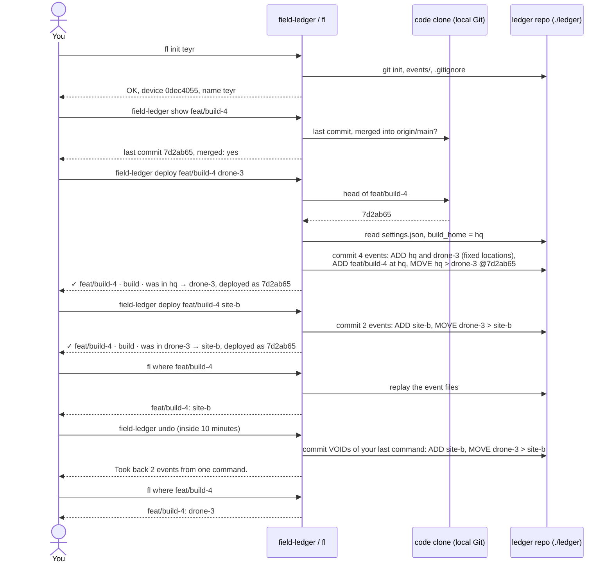

# field-ledger

A shadow board for things in flight. Everything checked out has a visible slot, and an
empty slot is a question someone has to answer.

**One tool, two modes:**

| Mode | Tracks | Answers |
|---|---|---|
| Field | Physical items: batteries, cameras, gazebos, vans | Where is BAT-12, and who moved it last? |
| Code | Branches and builds | Which build is at which location? Which branches are going stale? |

Both modes share one model (nodes, events, one replay function) and one command grammar.

Python 3.10+, standard library only. Nothing to install on a field laptop.

> **Status.** This README describes the target design. Each section says what works today
> (**v0**) and what is **planned**. If they disagree, the v0 line is what the code does.
>
> **Decisions vs mechanics.** Design decisions (the model, what events mean, the conflict and
> trust rules, scope, deadlines) live in a private design doc. This README is canonical for
> mechanics: commands, grammar, settings, file formats and setup. If the two disagree, the
> decision stands and this README gets fixed.

---

## Quick start (v0)

```bash
pip install -e .                     # installs the `fl` command
fl init teyr                         # once per laptop: creates ./ledger, sets your name
fl kit kit.csv                       # create item groups (see "Items and IDs")
fl move BAT-07 site-b                # log a move; prints the logged event and its ID
fl move BAT-07 CAS-01                # packs it into the case (CAS must be a container kind)
fl move CAS-01 van                   # ...and everything inside the case goes with it
fl where BAT-07                      # BAT-07: van (in CAS-01)
fl resolve BAT-07 van                # settle a ⚠ when two devices disagree
fl at site-b                         # everything there, including inside cases
fl flags                             # everything that needs a second look
fl undo                              # take back your own last command, within 10 minutes
fl void <event-id> "wrong battery"   # correct a mistake (history is kept)
```

Without installing: `python -m field_ledger.ledger`.

---

## The model

**Everything is a node.** A battery, a case, a van and a site are all nodes. Every node has:

- an **ID** (`BAT-12`),
- a **kind** (`battery`), which defines the states it can be in,
- one **parent**: the node it sits in (BAT-12 in Case A, Case A in the van, the van at Site B).

**Locations are fixed nodes.** A site or storeroom is a node flagged `fixed`: it can hold
things but can't be moved on the fast path. Locations can nest too (Site B > Storeroom).

**Contents follow their container.** Moving the van moves everything in it, in one event.
Moves that would create a loop (the van inside BAT-12) are rejected.

**Location and state are separate.** Where a battery is (its parent) and what's happening to
it (its state) change independently. Battery states by default:

| State | Meaning |
|---|---|
| `ready` | Charged, good to fly |
| `depleted` | Needs a charge |
| `storage` | Storage-charged for the long term |
| `damaged` | Puffed or dropped: don't fly it |

Kinds and their states are config, not code: add or edit them freely.

**Only log containment that lasts beyond a work session.** A battery's parent is its case,
charger station or van, never the drone it is flying in. Test: *would I chase someone about
where this is tomorrow?* If not, it isn't a parent.

**Bulk items** (cable ties, spare props) are one node with an optional count.

Status: **v0** has nesting, and `field-ledger deploy` creates its destination as a fixed
location node (moving one asks for confirmation). Locations named by `fl move` are still
free text, and older ledgers full of them keep working. Kinds and states are **planned**.

---

## Items and IDs

IDs are `KIND-NN`: a 3-letter prefix and a number (`BAT-07`, `GAZ-03`).

- The number's minimum width is a setting, `id_digits` (default `2`). Numbers past the width
  still work (`BAT-100`).
- Kit file:

  ```csv
  prefix,name,count,location,container
  BAT,Battery,12,truck,
  CAM,SIYI camera,3,case-1,
  CAS,Pelican case,2,truck,yes
  ```

  Creates `BAT-01`..`BAT-12`, `CAM-01`..`CAM-03` and `CAS-01`..`CAS-02`; cases can hold things
  (`container` is `yes`, `no`, or blank to leave the kind as it is). Re-running the same file changes nothing;
  raising a count only adds the missing items. `fl add BAT 2 --at truck` adds BAT-13, BAT-14.

Status: **v0** pads to 2 digits (fixed). `id_digits` is **planned**.

---

## Logging a move

**On a phone (planned):** tap an item, drag it to where it went. Under 2 seconds.
**From the CLI or chat (v0):** the text grammar below.

Every move prints a **readback** with the item's previous location:

```
✓ BAT-12 · Blue 6S · was in Case A → van        [Undo]
```

If the "was in" doesn't match what's in your hand, you have the wrong ID: tap Undo.

Status: **v0** `field-ledger deploy` prints the readback with the previous location
(`✓ feat/x · build · was in site-b → drone-3, deployed as 4b7e0d1`) and `fl undo` /
`field-ledger undo` cancel it. `fl move` still prints the logged event
(`logged: 5918e80f  BAT-02  van > site-b`); its readback is **planned**. The "from" side
is where the log last had the item, whether or not you typed one; a typed one is only
checked against it (`from-mismatch` below).

### Text grammar (v0)

The same grammar works with `fl run "..."`, imported files, and (planned) the phone board and bot.

```
MOVE <ITEM> [<FROM>] > <TO>     MOVE BAT-07 truck > site-B
WHERE <ITEM>
AT <LOCATION>
VOID <EVENT-ID> <reason>        VOID 3f9a2c1e wrong battery
RENAME <OLD> > <NEW>            RENAME site-bb > site-b   (location typo fix)
```

### What gets accepted (v0)

| Input | Verdict | Why |
|---|---|---|
| `MOVE BAT-07 > site-b` | OK | |
| `move bat7 > Site-B` | OK | ID format and case are canonicalised by fixed rules |
| `MOVE BTA-07 > site-b` | REJECT, "did you mean BAT-07?" | Fuzzy matches are suggested, never auto-corrected |
| `MOVE BAT-99 > site-b` | REJECT | Not in the kit. Add it with `fl add` |
| `MOVE BAT-07 truck > site-b`, log says `site-a` | WARN, written + `from-mismatch` | Someone moved it without logging. Rejecting would throw away true information |
| `MOVE BAT-07 > site-bb` (close to `site-b`) | CONFIRM, "did you mean site-b?" | Probable typo, caught before entry |
| `MOVE BAT-07 > site-b` when already at `site-b` | CONFIRM | Probably moved away and back without being logged |
| Same move, same person, within 2 minutes | IGNORED | Double tap |
| `MOVE BAT-07` | REJECT, shows usage | |

CONFIRM asks `Log it anyway? [y/N]`. `--yes` answers yes; with no terminal the answer is no.
Exit codes: `0` written or ignored, `1` rejected, `2` confirmation declined.

Planned change: once locations are fixed nodes, an unknown destination (`yoeng's bag`) is a
new *item* to create, not a new location.

### Corrections never edit history

| Mistake | Fix | Status |
|---|---|---|
| Just logged the wrong move | **Undo** within 10 minutes (`undo_minutes`). Undo takes back your own last command: every event it wrote (a deploy's new nodes and its move, a whole kit, a whole import) is voided together, except a node someone has used since. After the window it is refused and asks for `void <id> <reason>` | v0 |
| Older wrong entry | `fl void <id> <reason>`. The event stays, marked void; the item goes back to where it was | v0 |
| Location typo | `fl rename-location site-bb site-b`. Views show the new name; stored events keep what was typed | v0 |

---

## Who and when

Every event records:

| Field | Meaning |
|---|---|
| `logged_by` | Who logged it. Automatic: from the phone's device ID or the Telegram sender. **This is who gets chased** |
| `moved_by` | Who carried it, if different. Optional, defaults to `logged_by`, editable later |
| `actor_source` | `device`, `telegram` or `import` |
| `occurred_at` | When it happened (phone clock) |
| `recorded_at` | When the hub received it |
| `time_source` | `device`, `prompted` or `import`. A prompted time was typed in later and is approximate |

No logins and no PINs. The threat model is honest mistakes. On first open, a phone picks its
person from the ledger's **People** list.

Status: **v0** records `logged_by`, `device`, `occurred_at` and `recorded_at`. A board write
carries the phone's own time; `fl` stamps both with the laptop's. An event whose `occurred_at`
is more than 5 minutes after its `recorded_at` is flagged `future` (`fl flags`), and replay
counts every event at the earlier of the two, so a phone whose clock runs fast can't beat moves
logged after its event arrived. `moved_by` and `actor_source` are **planned**, and an imported
line is still attributed to the importer and timed at import.

---

## When two moves disagree

Normally the latest move wins. A move gets a **⚠** instead when all of these hold:

1. Two moves affect the same node's location (directly, or through its container),
2. their times are within `conflict_window`,
3. they disagree on the destination, **and**
4. they came from different devices, or either time is `prompted` / `import`.

Two exact-timed moves from the same phone never conflict: the phone's sequence number orders them.
Same destination from two devices is a duplicate and is merged.

A ⚠ item shows the latest location plus the other candidate. One tap confirms either and writes a
`RESOLVE` event. Anyone can resolve. A later move of the item settles it too: latest wins again.

**v0**: computed on every replay, never stored. `fl where` shows it and `fl resolve` settles it
(picking the other place moves the item there; `undo` brings the ⚠ back):

```bash
fl where BAT-01
# BAT-01: site-b  ⚠ or van
#   Two devices disagree. Settle it: fl resolve BAT-01 <site-b or van>
fl resolve BAT-01 van
```

An imported line counts as an approximate time (`time_source: import`, stored on the event),
so it gets the 60-minute window. In v0 its time is when it was imported. The bot nudge and the
field-ops owner are **planned**. A ⚠ older than `nudge_after` gets a bot nudge to the
ledger's **field-ops owner**.

**Every ledger has a field-ops owner**, picked from the People list when the ledger is created.
Nothing can be moved until one is set. Handover is its own event (`OWNER teyr → ivan`). Only the current owner can
hand over, except that anyone may claim ownership once a nudge has gone unanswered for
`nudge_after`; the claim is an ordinary, attributed `OWNER` event.

---

## In the field (planned)

| Piece | What it is |
|---|---|
| **Network** | A travel router (preferred) or a phone hotspot. Laptops join as normal clients. Don't use a laptop hotspot |
| **Hub** | One laptop runs `field-ledger serve`: it serves the phone board, writes events and commits them. Give it a fixed address on the router (DHCP reservation). **v0**: serves the board and takes its writes, including ones that waited on a phone (see "The hub" below) |
| **Phones** | Open the board in a browser and add it to the home screen. Moves queue on the phone if the hub is unreachable and send when it's back. **v0**: while the board is open (see "Phones offline") |
| **Relay** | When phones can't reach the hub (company or public Wi-Fi, or no hub on site), moves go through the Telegram bot. The hub fetches them over outbound HTTPS. The bot carries moves; it is never the record |
| **Backup** | The hub pushes the ledger repo when it has internet |

### The hub (v0)

```bash
field-ledger serve                             # this laptop: http://127.0.0.1:8765/
field-ledger serve --lan                       # phones on the field network too; prints the address
field-ledger serve --web-dir ~/designs/board   # try a design without touching the repo
```

**Using the board.** On first open a phone asks "Who are you?": pick your name, or add it once
("I'm new"). That name goes on every move you log. Then:

- **Move:** tap a card, then tap a place, or a card whose kind holds things (a case, a van) to
  pack it inside; tapping any other card picks that one instead. On a laptop, drag it. Or type
  where it went in the bar at the bottom. While a card is picked, the board holds other
  people's changes until you drop or cancel, and the status line says so.
- **Readback:** every write shows `✓ BAT-03 · Blue 6S · was in truck → van` with **Undo**.
  "Undo my last" in the header works for 10 minutes.
- **Asked first:** the same rules as `fl`. A new ID-shaped place or a fixed location asks
  before it logs; a refusal says why.
- **⚠:** a card two devices disagree on shows both places; pick it and tap where it really is.
- **Builds:** pick one to set its security label. **+ Add items** creates N more of a kind at a
  place, without the CLI.

`fl people` lists the names; `fl people add <name>` adds one; `fl init` adds its own.

**Phones offline.** Each write gets its event id, its time (`occurred_at`) and the phone's own
sequence number when it's tapped. If the hub can't be reached, a move, add, label or resolve
waits on the phone, the header shows **N unsynced**, and the write goes out by itself, oldest
first, when the hub is back: on reconnecting, on each 10-second refresh, and after each write.
The hub logs an event id once, so a resend is harmless ("already logged"). Undo and "I'm new"
need the hub.

A waiting write that the hub would refuse or ask about when it arrives is neither logged nor
dropped. It goes on **Needs a look** at the top of the board, for anyone to settle:

- **Log it anyway** (a question) or **Try again** (a refusal) writes it as its phone sent it:
  same person, time and sequence. Every rule still applies, so a refusal stays on the list.
- **Dismiss** logs nothing.

Each one is a file in the ledger repo, `needs-a-look/<event-id>.json`, committed when it
arrives. Settling writes who settled it, when, and how into the file, and the file stays.

**The plain http limit.** Waiting writes live in the browser's storage, so they survive closing
the tab, but clearing the browser's data loses them. The board itself only opens while the hub
is reachable. Opening it offline needs a service worker, and browsers allow those only on HTTPS
(or localhost), so keep the board open in the field. An HTTPS hub is **planned**.

**Which kinds hold things.** Only a container kind can have things packed into its items: a case,
a van, a drone a build is deployed onto. A kind holds nothing until someone says so, in the kit
file's `container` column (`yes`/`no`), with `fl add CAS 2 --at truck --container`,
`fl kind CAS container yes|no`, or the board's "+ Add items". Places always hold things;
builds never do. `fl move BAT-01 BAT-02` is refused: `BAT-02 can't hold things`.

**What it serves.** `GET /state.json` is the replayed state: every node with its place, container
chain and last event; a build's commit and label; any ⚠ with both places; the People list;
`needs_look`, the held writes nobody has settled.
`POST /api/move | undo | resolve | label | add` takes JSON naming the person (`actor`, from the
People list) and the browser (`device`), runs the same service functions as `fl`, and answers
`{verdict, messages, event, readback}`. A refusal is a verdict, not an error; a malformed request
is a 400. A phone adds `id` (a lowercase UUID, logged once), `occurred_at` (ISO, with a zone) and
`seq`, plus `queued: true` on a write that waited: the hub holds that one instead of refusing or
asking (`{..., held: true}`). `POST /api/settle {id, how: log | dismiss}` settles a held write.
`POST /api/people {name}` adds a name. Writes run one at a time: the hub is the only
committer. `GET /` is the board from `field_ledger/web/`: plain files, no build step.
`tokens.css` holds colours, spacing and type; each file in `components/` carries its own markup
and style; `board.js` wires them up and `api.js` does the writes. A design pass swaps the files;
`/state.json` and the API are the contract it must keep.

**Reaching it from phones.** Phones and the hub join the travel router. Then:

- **Ubuntu laptop:** `--lan` is enough. If `ufw` is on: `sudo ufw allow 8765/tcp`.
- **Windows laptop, hub in WSL2:** WSL2's default (NAT) networking hides the hub from the
  network, and `serve --lan` says so. One-time fix, either:
  1. **Mirrored networking** (Windows 11 22H2 or later). Put this in `%UserProfile%\.wslconfig`,
     run `wsl --shutdown`, then allow the port in an admin PowerShell:
     ```
     [wsl2]
     networkingMode=mirrored
     ```
     ```powershell
     New-NetFirewallHyperVRule -Name field-ledger -DisplayName "field-ledger hub" -Direction Inbound -VMCreatorId '{40E0AC32-46A5-438A-A0B2-2B479E8F2E90}' -Protocol TCP -LocalPorts 8765
     ```
  2. **Port proxy** (any Windows; redo it after each WSL restart, because WSL's address
     changes). In an admin PowerShell, with the address `hostname -I` prints inside WSL:
     ```powershell
     netsh interface portproxy add v4tov4 listenport=8765 listenaddress=0.0.0.0 connectport=8765 connectaddress=<WSL address>
     New-NetFirewallRule -DisplayName "field-ledger hub" -Direction Inbound -Protocol TCP -LocalPort 8765 -Action Allow
     ```

  Tried 2026-10-28 on a Windows 11 laptop with option 1: a phone on the same Wi-Fi opened the
  board. Watch for Notepad saving `.wslconfig.txt`; WSL only reads `.wslconfig`. The Ubuntu
  laptops and option 2 are not tried yet.

### Takeover: the hub laptop dies

1. Stop the old hub if it's still running (only one hub may poll the bot).
2. On another laptop: clone the ledger repo (from its remote, or a USB `git bundle`).
3. Copy the bot token file (see "Secrets").
4. Run `field-ledger serve`. Phones send their queued moves; the bot hands over anything it held.

Telegram keeps relayed moves for 24 hours. After that, recover them from a chat export with
`fl import`.

### No laptop on site

Phones must already have the board installed. Moves go through the bot; if a move has no time,
the bot asks for one. A rough time beats none, and it's marked `prompted`.

### v0 today

| Situation | What to do |
|---|---|
| No network at all | Every laptop logs to its own ledger repo. Afterwards: `git pull` in `ledger/` from the other laptop (or a USB `git bundle`); `fl` picks up the new event files on its next run |
| An older ledger (SQLite only) | `fl merge other-laptop.db` copies its events in and writes them as event files |
| Phones only | Type commands into chat or a notes app, then `fl import notes.txt` |

`fl import` picks up UPPERCASE commands anywhere in a line, so a chat export line like
`[17/10/26, 13:05] Teyr: MOVE BAT-07 > site-B` works and ordinary chat is skipped. Re-running
`merge` or `import` adds nothing twice, and a line that repeats the previous move of the same
item (same destination) is ignored, judged from the text alone. v0 limit: imported lines are attributed to the importer
and timestamped at import time.

---

## Code mode

A build is a node of kind `build`. Its parent is where it is deployed:

```bash
field-ledger deploy feat/secure-cdr drone-3 --repo /path/to/repo
# ✓ feat/secure-cdr · build · was in site-b → drone-3, deployed as 4b7e0d1
```

The destination may be a location (created as a fixed location node the first time it is
named) or an item ID, which deploys the build onto that thing. A destination shaped like an
item ID (three letters and a number) is checked against the kit. If the ledger has a DRN kit
but no DRN-03, `deploy feat/x DRN-03` is refused as a typo (`DRN-03 is not in the kit`). If
there is no DRN kit at all, it may be a real place (a building number, `Blk 12`), so it asks
once (`--yes` to skip); from then on it's a known place. The same goes for `fl move`, and
the phone board will follow the same rule: it goes through the same service layer. The deploy records the
branch's head commit in the event's `sha` field (full SHA; empty if unknown), read from
`--repo` without fetching; with no such branch there the move is still recorded and the
readback says `commit unknown`. `field-ledger undo` takes it back within 10 minutes.

Code comes from somewhere too: a build's first deploy starts at `build_home` (default `hq`,
change it with `fl set build_home <location>`), so it reads `was in hq → drone-3`, and
undoing that first deploy takes all of it back: the build node and any location it created.

Branch age, last commit and merge state come from **local Git** and work offline and airgapped.

```bash
field-ledger show feat/secure-cdr --repo /path/to/repo   # no fetch
# feat/secure-cdr
#   age: 2 day(s) since the last commit
#   last commit: 9c1d4ae  2026-10-26 18:40  teyr  harden the CDR path
#   merged into origin/main: no
#   at drone-3, deployed as 4b7e0d1
#   moved on since deploy: deployed as 4b7e0d1, head is now 9c1d4ae
#   security label: HIGH
```

When the branch has moved on since its deploy, `show` says so. It only warns: nothing is
written, and the label doesn't change. PR/MR status from GitHub or GitLab is optional and
needs a token.

Each build carries a **security label**, set by hand (no scanner): exactly `CRIT`, `HIGH`,
`MED`, `LOW` or `NA`, with an optional reason kept on the SEC event. The latest wins; `undo`
or `void` brings the previous one back. A build nobody has labelled shows `none set`, which
is not the same as `NA` (checked, not applicable). **v0**:

```bash
field-ledger label feat/secure-cdr HIGH opens the CDR port to the site LAN
# SEC feat/secure-cdr · drone-3 · was LOW → HIGH
```

### Sample: one build, end to end (v0)

The stage 5 trial (2026-10-28), run on a fresh clone of this repo. Every command reads
local Git only; nothing is fetched.



The tool repo's `git status` stays clean throughout: the ledger is its own repo in a
gitignored folder.

### Stale-work board (v0)

Every remote branch is a tool checked out; a branch merged and deleted is a tool back in its slot.

| Label | Meaning | Usual fix |
|---|---|---|
| `no-PR` | Branch exists, nobody has been asked to review it | Open the PR, or delete the branch |
| `PR-stale` | PR open, untouched for more than `--stale-days` | Ping the reviewer, or close it |
| `merged-not-deleted` | Every commit already in `--base` | Delete the remote branch |
| `in-flight` | PR open and moving | Nothing |
| `branch-gone` | The ledger has it deployed, but its branch no longer exists | Confirm with `fl where`, update with `fl move <build> <location>` |
| `base` | The base branch itself (e.g. `main`), deployed somewhere per the ledger | Nothing; Build shows which commit, and `(moved on)` once `main` has moved past it |

```bash
python -m field_ledger --repo /path/to/repo --base origin/develop
python -m field_ledger --repo /path/to/repo --base origin/develop --prs gh --hide-in-flight
```

**This is the 10-30 board.** When a ledger is there (`--ledger-dir`, default `./ledger`) it
adds three columns, read straight from the event files, offline and without writing anything:
**Location** (with `⚠ <other place>` when two devices disagree), **Build** (the deployed commit,
`unknown`, and `(moved on)` when the branch has new commits since) and **SEC** (the label, blank
if nobody has set one). A deployed build whose branch was merged and deleted gets a
`branch-gone` row of its own. Without a ledger the table is exactly as above.

```
branch-gone: 1 (confirm with fl where, update with fl move <build> <location>) · no-PR: 2

| Label | Branch | Age (d) | Author | PR | Location | Build | SEC |
|---|---|---|---|---|---|---|---|
| branch-gone | `feat/old-site` | - | - | - | site-a | da94d1f | LOW |
| no-PR | `feat/build-6` | 0 | TeyrCrimson | - | site-b | 231ce51 |  |
| no-PR | `feat/build-7` | 0 | TeyrCrimson | - | drone-3 | 3c533aa | HIGH |
```

It runs `git fetch --prune` first (`--no-fetch` skips it and works offline). Use a full clone:
a shallow one breaks `merged-not-deleted`. On WSL, repos under `/mnt/c/...` work but Git is slower.

Known gaps: `--prs glab` flags differ across glab versions (NEEDS VERIFICATION); `--prs gh` is
unit-tested but not yet run against a live repo; fork PRs are matched by branch name only.

---

## Storage and privacy

This tool's repo is **public**. Ledger data never goes in it.

- **The record:** each ledger is its own Git repo inside a gitignored folder (`ledger_dir`,
  default `./ledger`), created by `field-ledger init` (`--ledger-dir` to put it elsewhere).
  One JSON event file per move, committed as it is written; Git gives history, merge and
  offline commits. A new file is never a merge conflict, so two people logging offline is a
  non-event. Give it a private or internal remote, or none on airgapped sites.
  Running `init` twice is safe: nothing already on disk is touched.
- **The cache:** one SQLite file, `./field-ledger.db` (override with `--db` or `FL_DB`),
  gitignored. `fl` writes every event to the files first, then the cache, and picks up new
  files (from a `git pull`) each time it starts. `fl rebuild` recreates it from the files;
  `--ledger-dir` / `FL_LEDGER_DIR` point `fl` at a ledger elsewhere.

### Secrets

Bot tokens and forge tokens live in a local, gitignored file or an environment variable.
Never commit them. Copying the token file is part of takeover.

---

## Settings

| Setting | Default | What it does |
|---|---|---|
| `id_digits` | `2` | Minimum width of the ID number |
| `undo_minutes` | `10` | How long the one-tap Undo is offered |
| `conflict_window` | `5 min` device / `60 min` prompted or import | How close two moves must be to get a ⚠ |
| `nudge_after` | `1` working day | When an unresolved ⚠ nudges the field-ops owner |
| `ledger_dir` | `./ledger` | Where the ledger's own repo lives |
| `build_home` | `hq` | Where a build is before its first deploy. **v0**: `fl set build_home <location>`; stored in the ledger repo's `settings.json`, so every device shares it |

**v0**: only `build_home` can be changed (`fl set`). `ledger_dir` comes from `--ledger-dir` or
`FL_LEDGER_DIR`. `undo_minutes` and `conflict_window` are in force at their defaults but fixed.
`id_digits` and `nudge_after` are **planned**.

---

## Layout (v0)

| Module | Job | Pure? |
|---|---|---|
| `ledger/model.py` | Data types | yes |
| `ledger/ids.py` | Item ID and location rules | yes |
| `ledger/parse.py` | Text grammar | yes |
| `ledger/state.py` | Events to current state | yes |
| `ledger/validate.py` | Accept/reject rules | yes |
| `ledger/kit.py` | Kit file, numbering | yes |
| `ledger/importer.py` | Finding commands in text | yes |
| `ledger/store.py` | Event files (the record), SQLite cache, merge, Needs a look files | no |
| `ledger/service.py` | Validate, then write | no |
| `ledger/cli.py` | `fl` command; opening a ledger, shared with code mode | no |
| `cli.py` | `field-ledger` command: board, `show`, `deploy`, `label`, `undo`, `serve` | no |
| `hub.py` | The hub: `/state.json`, the web front end, and the board's writes (`/api/*`) | no |
| `web/` | The board: `tokens.css`, `components/*.js`, `board.js`, `api.js`. No build step | (front end) |

## Tests

```bash
pip install pytest
python -m pytest -q
```
